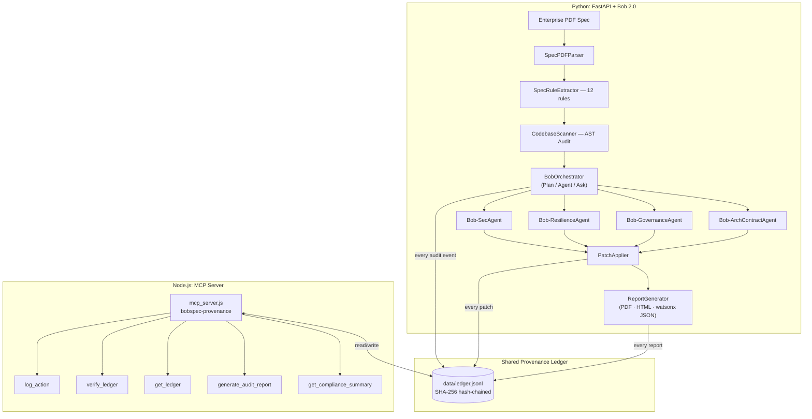

# BobSpec-Provenance

> **IBM Bob 2.0 · Full DevSecOps Lifecycle · Tamper-Evident Audit Trail**
> *TicketProof-main · BobSpec · ReleaseProof AI · Provenance MCP — unified*

---

## 🎤 Pitch Opening

> *"EU AI Act Article 12 requires every consequential AI decision to be auditable. We built the only system that covers the complete chain — from ticket to human release approval — cryptographically."*

---

## 🚨 The Regulatory Problem This Solves

**The EU AI Act (Articles 12 & 14), HIPAA §164.312, FedRAMP AC-2, and SOC 2 CC6.1 all share one requirement: every consequential AI decision must be logged in an immutable, auditable trail that humans can inspect and override.**

Today's enterprise AI pipelines — code audits, compliance sweeps, automated patching — produce *no* verifiable record of what the AI did, when, and why. A regulator, auditor, or security officer cannot answer:

- *"Which AI agent changed this file, and on whose authority?"*
- *"Has this audit log been altered since it was written?"*
- *"Does this system satisfy EU AI Act Article 14 human-oversight requirements?"*

**BobSpec-Provenance answers all three questions** — and now covers the **complete software delivery lifecycle**, from ticket to human approval, in one cryptographically chained record.

---

## 🏗️ The 4-Stage Pipeline

```
Stage 1: TicketProof-main          Stage 2: BobSpec-Provenance
──────────────────────────         ─────────────────────────────────────
Ticket/PRD → parse ACs →           PDF spec → 4 Bob subagents →
Bob Shell remediation hints →      AST violations → auto-patches →
AC coverage % score                watsonx.governance manifest
         │                                      │
         └──────── data/ledger.jsonl ───────────┘
                         │
         ┌───────────────┴────────────────────────┐
         │                                        │
Stage 3: ReleaseProof AI              Stage 4: Human Gate (EU AI Act Art.14)
─────────────────────────             ──────────────────────────────────────
5 CI checks (pytest, secrets,         Approve / Reject with actor +
lint, diff, files) → risk score       reason + timestamp → ledger closes
→ PASS / WARN / BLOCK
```

Every stage writes into **`data/ledger.jsonl`**. The SHA-256 chain is unbroken from the first ticket parse to the final human approval decision. The `watsonx.governance` manifest includes AC coverage, release gate outcome, and chain integrity status.

---

## 🎯 What Is This?

**BobSpec-Provenance** is the integration hub for four complementary projects:

| Project | Stage | Contribution |
|---------|-------|-------------|
| **TicketProof-main** | 1 | Ticket/PRD → AC coverage audit → Bob Shell LLM remediation hints → audit history |
| **BobSpec** (IBM HACK) | 2 | IBM Bob 2.0 multi-agent AST compliance verifier — ingests PDF specs, detects violations, synthesizes patches |
| **ReleaseProof AI** | 3 | 5 CI checks → calibrated risk score → PASS/WARN/BLOCK — zero dependencies |
| **Provenance MCP** | ★ | SHA-256 hash-chained tamper-evident ledger shared by all stages |

The integration is **deep and non-overlapping**: every stage covers a different lifecycle phase. The shared `data/ledger.jsonl` file is the single source of truth across all four systems.

---

## ✅ Test Suite

```bash
pip install pytest
pytest tests/ -v
# → 23 passed in < 1s
```

Coverage: SHA-256 hash-chain integrity (append, linking, tamper detection, concurrency) + AST compliance rules SEC-001 (hardcoded secrets), SEC-003 (SQL injection), GOV-001 (PII logging).

---

## 🏗️ Architecture



---

## 🚀 Quickstart

### Prerequisites
- Python 3.10+
- Node.js 18+

### 1. Install dependencies

```bash
pip install -r requirements.txt
npm install
```

### 2. Launch Web Dashboard (Python)

```bash
python run_server.py
# → http://127.0.0.1:8000
```

Or use the one-liner scripts:

```bat
run.bat        # Windows CMD
.\run.ps1      # PowerShell
```

### 3. Launch MCP Server (Node.js)

```bash
node mcp_server.js
# Reads/writes the same data/ledger.jsonl as the Python server
```

### 4. Run Standalone CLI (for CI/CD)

```bash
# Full audit + patch + reports
python cli.py --patch --report

# Verify the hash-chain integrity only
python cli.py --verify-ledger

# Custom spec and target directory
python cli.py --spec enterprise_specs/Enterprise_FinTech_Cloud_Architecture_v4.pdf --target sample_codebase --patch
```

---

## 🧩 Bob 2.0 Modes

| Mode | What it does |
|------|-------------|
| **Plan Mode** | Constructs a 5-stage execution DAG, partitions rules across 4 specialized subagents, estimates 3.8x parallel speedup |
| **Agent Mode** | Dispatches violations to Bob-SecAgent, Bob-ResilienceAgent, Bob-GovernanceAgent, Bob-ArchContractAgent in parallel; synthesizes unified diffs |
| **Ask Mode** | Natural-language compliance advisory — answers questions about SEC-001, circuit breakers, PII masking, GDPR, scoring, and the provenance ledger |

---

## 🔗 Provenance Ledger

Every action taken by BobSpec is **automatically written** to `data/ledger.jsonl`:

| Event | Who Logs It |
|-------|-------------|
| `spec_loaded` | Web app on startup or spec switch |
| `plan_generated` | BobOrchestrator — Plan Mode |
| `audit_started` / `audit_complete` | BobOrchestrator — Agent Mode |
| `subagent_audit_complete` | Each of the 4 specialized subagents |
| `patch_applied` | PatchApplier — per-patch |
| `patch_verification` | PatchApplier — post-scan summary |
| `report_generated` | ReportGenerator — PDF, HTML, watsonx JSON |
| `advisory_query` | BobOrchestrator — Ask Mode |
| `codebase_reset` | Web app — reset demo |

Each entry is SHA-256 hashed over its own content chained to the previous entry's hash (`prevHash`). Any post-hoc edit breaks the chain and is detected by `verify_ledger`.

### MCP Tools

| Tool | Description |
|------|-------------|
| `log_action` | Append a tamper-evident entry + compliance classification |
| `verify_ledger` | Recompute every hash and prevHash link; detect tampering |
| `get_ledger` | Return all entries, optionally filtered by `minRisk` |
| `generate_audit_report` | Full Markdown report: integrity, BobSpec events, full log |
| `get_compliance_summary` | Aggregate stats: risk distribution, framework coverage, audit counts |

### MCP Client Config (`.bob/mcp.json`)

```json
{
  "mcpServers": {
    "bobspec-provenance": {
      "command": "node",
      "args": ["/absolute/path/to/bobspec-provenance/mcp_server.js"],
      "env": {
        "PROVENANCE_LEDGER_PATH": "${workspaceFolder}/data/ledger.jsonl"
      }
    }
  }
}
```

---

## 🌐 Web Dashboard Tabs

| Tab | Content |
|-----|---------|
| **Violations & AST Audit** | All detected compliance violations with severity, file/line, AST snippet, domain filter |
| **Targeted Patches** | Unified diffs synthesized by Bob 2.0 subagents; Apply & Re-Verify button |
| **Bob 2.0 Agentic Canvas** | Subagent telemetry cards + Plan Mode execution DAG |
| **Spec & Extracted Rules** | Parsed specification document, all extracted ComplianceRule objects |
| **Ask Bob (Advisory)** | Conversational compliance advisor (Ask Mode) |
| **Provenance Ledger** ⭐ NEW | Live hash-chained ledger table, chain integrity banner, risk filter, Verify Chain button |
| **Governance Reports** | Download PDF, watsonx.governance JSON manifest, Provenance Markdown report, MCP server info |

---

## 📊 API Endpoints

### Existing (from BobSpec)

| Method | Path | Description |
|--------|------|-------------|
| `GET` | `/` | Web dashboard |
| `GET` | `/api/state` | Full live state |
| `GET` | `/api/specs` | List available spec PDFs |
| `POST` | `/api/specs/select` | Switch active specification |
| `POST` | `/api/audit/run` | Re-run compliance audit |
| `POST` | `/api/patches/apply-all` | Apply all patches + re-verify |
| `POST` | `/api/codebase/reset` | Reset to unpatched baseline |
| `POST` | `/api/ask` | Ask Mode advisory query |
| `GET` | `/api/reports/download-pdf` | Download executive PDF report |
| `GET` | `/api/reports/download-watsonx` | Download watsonx.governance manifest |

### New (from Provenance MCP)

| Method | Path | Description |
|--------|------|-------------|
| `GET` | `/api/ledger/entries?min_risk=` | All entries with compliance classification |
| `GET` | `/api/ledger/verify` | Verify SHA-256 hash-chain integrity |
| `GET` | `/api/ledger/report` | Markdown provenance audit report |

---

## 📋 Compliance Frameworks Covered

| Framework | Coverage |
|-----------|----------|
| **PCI-DSS v4.0** | SEC-001 (secrets), SEC-002 (TLS), SEC-003 (SQL injection), GOV-001 (PAN masking) |
| **ISO 27001** | SEC-001, SEC-002 |
| **HIPAA §164.312** | HIPAA-SEC-01, HIPAA-GOV-02, HIPAA-RES-03 |
| **SOC 2 CC6.1** | GOV-002 (audit trails) |
| **GDPR Art. 32** | GOV-001 (PII masking) |
| **NIST SP 800-52** | SEC-002 (TLS) |
| **OWASP ASVS 5.4** | ARCH-002 (stack trace leakage) |
| **EU AI Act Art.12/14** | Provenance ledger — transparency & human oversight logging |
| **FedRAMP AC-2** | Provenance ledger — account management audit trails |

---

## 📁 Project Structure

```
bobspec-provenance/
├── mcp_server.js              ← Node.js MCP server (5 tools)
├── package.json
├── requirements.txt
├── setup.py
├── run_server.py              ← Launch Python web server
├── cli.py                     ← CI/CD standalone CLI
├── run.bat / run.ps1          ← One-liner launchers
├── data/
│   └── ledger.jsonl           ← Shared provenance ledger (shared by Python + Node.js)
├── enterprise_specs/          ← Auto-generated PDF specs
├── sample_codebase/           ← Target codebase for demo
├── reports/                   ← Generated PDF/HTML/JSON reports
└── bob_verifier/
    ├── config.py              ← Data models (Pydantic)
    ├── ledger/
    │   └── provenance_ledger.py  ← Python ledger module
    ├── agents/
    │   ├── bob_orchestrator.py   ← Bob 2.0 orchestrator (writes to ledger)
    │   ├── security_agent.py
    │   ├── resilience_agent.py
    │   ├── governance_agent.py
    │   └── contract_agent.py
    ├── audit/
    │   ├── ast_analyzer.py
    │   ├── scanner.py
    │   ├── resilience_helpers.py
    │   └── rbac_helpers.py
    ├── ingestion/
    │   ├── pdf_parser.py
    │   ├── rule_extractor.py
    │   └── spec_generator.py
    ├── patcher/
    │   └── patch_applier.py      ← Writes to ledger on each patch
    ├── reporting/
    │   └── report_generator.py   ← Writes to ledger + includes ledger in HTML/JSON
    └── web/
        ├── app.py                ← FastAPI + 3 new ledger endpoints
        └── static/
            ├── index.html        ← 7-tab UI (incl. Provenance Ledger tab)
            └── app.js
```

---

## 🔒 watsonx.governance Audit Manifest

Every audit generates a cryptographic SHA-256 signature that includes the provenance chain status:

```json
{
  "$schema": "https://ibm.com/watsonx/governance/audit-manifest-v2.json",
  "audit_metadata": {
    "framework": "BobSpec-Provenance: IBM Bob 2.0 + Tamper-Evident Ledger",
    "audit_signature_sha256": "b6a4f6d6...",
    "status": "VERIFIED_COMPLIANT_WITH_PATCHES"
  },
  "provenance_ledger": {
    "chain_valid": true,
    "entry_count": 18,
    "breaks": [],
    "compliance_frameworks": ["EU AI Act Art.12", "HIPAA §164.312", "FedRAMP AC-2", "SOC2 CC6.1"]
  }
}
```

---

Built with IBM Bob 2.0 agentic design patterns and the Provenance tamper-evident ledger.
